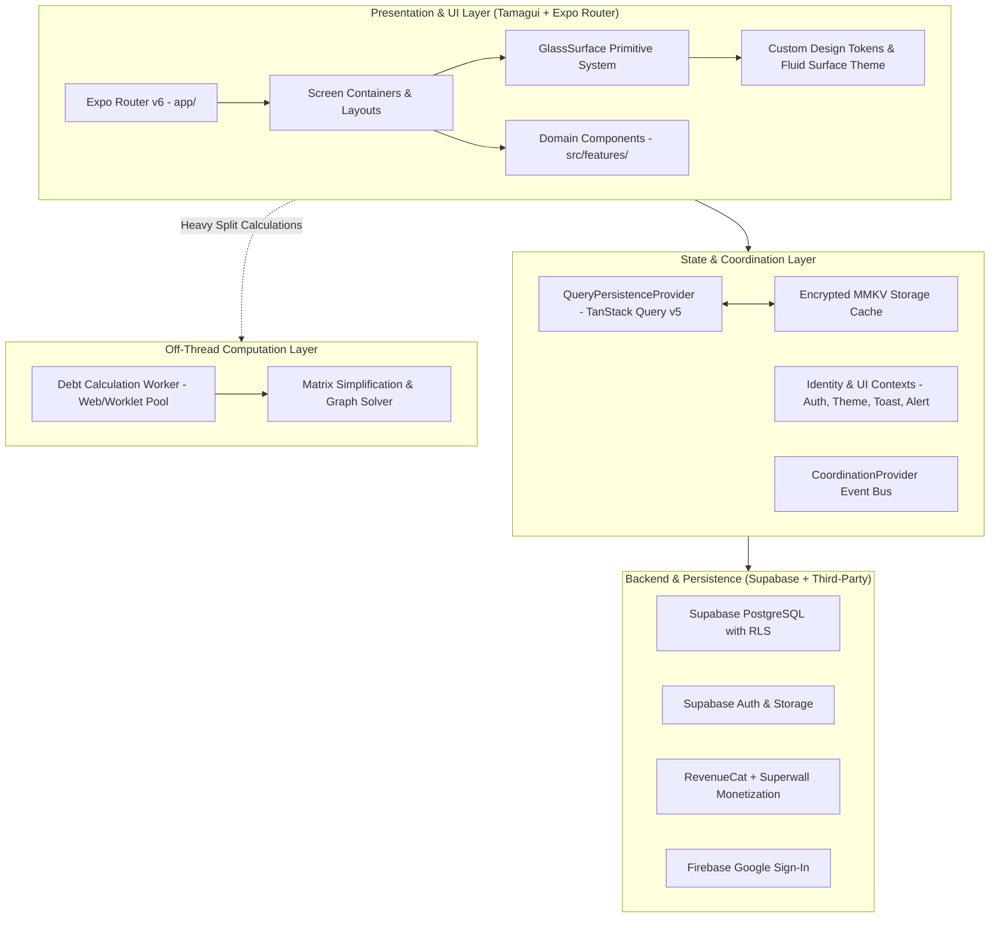
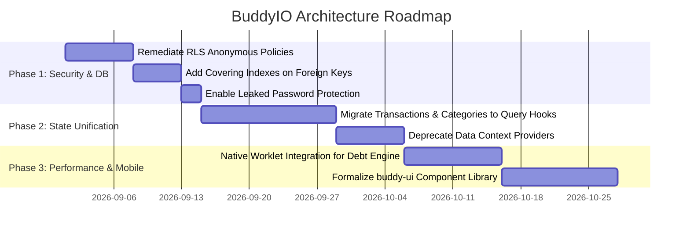

# BuddyIO — Senior Principal Architect Analysis Report

**Author**: Senior Principal Systems Architect  
**Project**: BuddyIO (Personal Finance & Expense-Sharing Mobile Platform)  
**Date**: August 2026  
**Target Platform**: Android & iOS (React Native 0.86 / Expo SDK 57 New Architecture)  
**Status**: Active Development & Hardening

---

## 1. Executive Summary

BuddyIO is a modern personal finance, budget tracking, tracker management, and group expense-splitting mobile application. The codebase has undergone significant structural evolution—migrating from monolithic state management to a domain-driven modular feature architecture backed by TanStack React Query, encrypted MMKV offline persistence, and Tamagui v1.141 design primitives.

### Architectural Maturity Scorecard

| Dimension                          |    Score     | Assessment          | Key Driver                                                                                                  |
| :--------------------------------- | :----------: | :------------------ | :---------------------------------------------------------------------------------------------------------- |
| **Type Safety & Code Quality**     | **9.5 / 10** | **Exceptional**     | Strict TypeScript (zero errors), automated quality gates, custom ESLint AST rules.                          |
| **Maintainability & Modularity**   | **8.5 / 10** | **Very High**       | Clean feature slice organization (`src/features/*`), clear path aliasing, domain separation.                |
| **UI/UX Architecture**             | **8.5 / 10** | **Very High**       | Fluid Surface design system, strict surface ownership (`ScreenContainer` + `GlassSurface`), Tamagui tokens. |
| **Performance & Responsiveness**   | **8.0 / 10** | **High**            | Off-thread debt calculation algorithms, FlashList virtualization, sub-minute Gradle fast build paths.       |
| **State Management Cohesion**      | **7.5 / 10** | **Moderate-High**   | Successful query-first migration in progress; hybrid context/query footprint remains in some modules.       |
| **Testability & Test Coverage**    | **7.0 / 10** | **Moderate**        | Solid contract and utility testing; heavy service singleton usage limits unit mock isolation.               |
| **Security & Database Layer**      | **6.5 / 10** | **Needs Attention** | Unindexed foreign keys and broad RLS anonymous-role permissions identified in Supabase advisor.             |
| **Overall Architectural Maturity** | **7.9 / 10** | **Strong (B+)**     | Highly structured, production-ready foundation with specific database and state-refinement actions needed.  |

```mermaid
radar
  title "BuddyIO Architectural Maturity Dimensions"
  "Type Safety": 9.5
  "Maintainability": 8.5
  "UI System": 8.5
  "Performance": 8.0
  "State Cohesion": 7.5
  "Testability": 7.0
  "Security & DB": 6.5
```

---

## 2. System Architecture & Topology



---

## 3. Key Architectural Strengths

### 3.1 Modern, Strict Technology Foundation

- **React Native 0.86 + Expo SDK 57 (New Architecture enabled)**: Leverages Fabric renderer and TurboModules for optimal native bridge performance.
- **Strict TypeScript 6.0**: Strict type checking enforced across all features, interfaces, and services with **zero type errors**.
- **Automated Quality Gates**: Custom ESLint plugins (`eslint-rules/context-patterns`, `eslint-rules/development-quality`) enforce Tamagui usage and ban legacy anti-patterns (`AppContext`, `console.log`, raw `Alert.alert`).

### 3.2 Fluid Surface Design System & Surface Ownership

- **Strict Surface Separation**:
  - `ScreenContainer` manages edge-to-edge rendering, safe-area insets, and the background blur target.
  - `GlassSurface` is the single canonical primitive owning elevation, light-catching gradient edges, 16–20pt radii, and smooth platform fallback.
- **Platform-Optimized Rendering**: Seamlessly provides native blur on iOS while executing Expo's smooth translucent fallback on Android to eliminate Dimezis native renderer noise and stipple artifacts.

### 3.3 Offline-First TanStack Query + MMKV Persistence

- High-performance caching using `MMKVPersister` with encrypted key-value storage.
- Immediate shell hydration (`first_shell` telemetry marker) ensuring instant startup and offline accessibility for previously fetched data.

### 3.4 Off-Thread Computational Scalability

- Group expense debt simplification algorithms (settlement matrix calculations) are offloaded to dedicated workers (`debtCalculation.worker.ts`), reducing time complexity from $O(n^3)$ to $O(n^2)$ with LRU hashing and avoiding UI thread frame drops for large groups (20+ members).

### 3.5 High-Speed Android Native Development Loop

- Configured native Gradle hard-link caching across volume boundaries (`$env:GRADLE_USER_HOME = 'F:\.gradle'`).
- Single-ABI debug assembly target (`arm64-v8a`), achieving warm compilation in **~36 seconds**.

---

## 4. Architectural Risks & Tech Debt Analysis

> [!WARNING]
> The following areas represent high-priority technical debt and architectural risks that require targeted remediation before production deployment.

### 4.1 Database Layer: Unindexed Foreign Keys & RLS Permissiveness (Critical)

Based on Postgres linter audits:

1. **Unindexed Foreign Keys**:
   - `transactions(category_id)` and `transactions(paid_by)`
   - `budgets(category_id)`
   - `groups(created_by)`
   - `investments(portfolio_id)`
   - `loan_payments(loan_id)`
   - `subscription_payments(subscription_id)`
     _Impact_: As tables grow to tens of thousands of rows, cascade operations, filter queries, and joins will trigger sequential table scans, degrading response times.
2. **Anonymous Access on RLS Policies**:
   - RLS policies on tables like `budgets`, `categories`, `credit_cards`, `groups`, `transactions`, and `storage.objects` apply to the public role without strictly specifying `TO authenticated`.
     _Impact_: Increases vulnerability to unauthorized operations if anonymous authentication tokens are generated.

### 4.2 State Management: Hybrid Context/Query Footprint (Moderate)

- While `LoanContext.query` and `SubscriptionContext.query` represent a clean migration to React Query, other domains (e.g., `CategoryContext`, `TransactionContext`, `GroupContext`) still maintain custom React Context state layers alongside query caching.
- _Recommendation_: Complete the query-first migration so Context only stores UI/session state (Theme, Active Modals, Active Auth Session), letting TanStack Query manage all server entity caches with automatic optimistic updates.

### 4.3 Service Layer: Direct Singleton Coupling (Moderate)

- Services in `src/services/` (e.g., `SupabaseDatabaseService`, `SupabaseAuthService`, `ProductionConfigService`) use static `getInstance()` singletons without dependency injection interfaces.
- _Impact_: Testing business logic requires heavy module mocking (`jest.mock(...)`) rather than passing lightweight repository stubs.

---

## 5. Strategic Architectural Roadmap



### Phase 1: Security & Database Hardening (Immediate — P0)

1. **Apply Foreign Key Covering Indexes Migration**:
   ```sql
   CREATE INDEX IF NOT EXISTS idx_transactions_category_id ON public.transactions(category_id);
   CREATE INDEX IF NOT EXISTS idx_transactions_paid_by ON public.transactions(paid_by);
   CREATE INDEX IF NOT EXISTS idx_budgets_category_id ON public.budgets(category_id);
   CREATE INDEX IF NOT EXISTS idx_groups_created_by ON public.groups(created_by);
   CREATE INDEX IF NOT EXISTS idx_investments_portfolio_id ON public.investments(portfolio_id);
   CREATE INDEX IF NOT EXISTS idx_loan_payments_loan_id ON public.loan_payments(loan_id);
   CREATE INDEX IF NOT EXISTS idx_sub_payments_sub_id ON public.subscription_payments(subscription_id);
   ```
2. **Restrict RLS Roles to Authenticated**:
   Refactor RLS policies to specify `TO authenticated` explicitly across all sensitive user and financial tables.
3. **Drop Unused Indexes**:
   Remove redundant non-filtering indexes identified in Supabase lints (`idx_transactions_group_id`).

### Phase 2: State Layer Standardization (P1)

1. **Query-First Domain Hooks**:
   - Refactor `useTransactions`, `useCategories`, and `useGroups` to directly wrap TanStack `useQuery` / `useMutation` hooks.
   - Remove redundant state synchronization boilerplate from Context providers.
2. **Lean Provider Tree**:
   - Flatten `AppProviders.tsx` by eliminating data-holding context providers, reducing root re-render propagation.

### Phase 3: Computation & Monorepo Maturation (P2)

1. **Native Worklet Integration**:
   - Standardize debt calculation engine to run via `react-native-worklets-core` on mobile runtime, ensuring seamless background processing across low-end Android hardware.
2. **Monorepo Package Isolation**:
   - Mature `packages/buddy-ui` as a completely decoupled UI package with dedicated test and build harnesses.

---

## 6. Conclusion

BuddyIO demonstrates exemplary software craftsmanship in type safety, UI design discipline, and code hygiene. By executing the targeted database indexing, RLS policy hardening, and query-first state normalization outlined above, the architecture will reach Tier-1 production standards for enterprise-grade performance and security.
