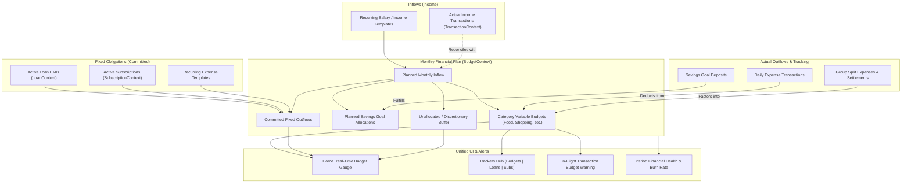

# Budget Architecture & Integration Analysis

> **Status:** Repository Implementation Complete; Hosted Supabase Migration Applied; Native Runtime Verification Pending  
> **Target System:** BuddyIO Personal Finance & Expense-Sharing Platform  
> **Date:** August 2026

---

## 1. Executive Summary

A comprehensive audit of the BuddyIO codebase—spanning database schema, persistence layer, React context/query architecture, hooks, screen modules, and calculation engines—reveals that the **Budget** subsystem is currently operating as a semi-isolated feature rather than the **central financial operating system** of the application.

While rich UI components and sophisticated domain types exist for budgeting, the feature suffers from:

1. **A persistence and data model mismatch** between the Supabase PostgreSQL database schema and the client-side domain types.
2. **Local-only persistence (`AsyncStorage`)** in the active budget service, bypassing cloud sync and user isolation.
3. **Critical calculation bugs on the Home screen**, where monthly income is mistaken for total budget and planned expenses are displayed as actual spending.
4. **Disconnection from live transaction flows** (incomes and expenses recorded in `TransactionContext` do not actively inform in-flight spending guardrails).
5. **Complete isolation from Fixed Obligations** (active Loans and Subscriptions) and **Savings Goals**.
6. **Absence from the main Trackers navigation hierarchy** (`TrackerScreen` only supports Loans and Subscriptions).
7. **Orphaned intelligence engines** (`SmartBudgetService`, `GroupBudgetService`, and `FinancialCalculationService` are unimported and unused).

This document details the exact technical disconnects across the codebase and outlines the target architecture for a fully unified financial ecosystem.

## 1.1 Validated Architecture Decision (Implemented August 29, 2026)

The audit findings above were validated against the live feature-first implementation. The target architecture is now based on one strict ownership rule:

- **Budget owns intent:** income baseline, flexible-spending limit, planned savings, category allocations, income sources, recurring links, and savings-goal allocations.
- **Domain features own facts:** Transactions own actual inflows/outflows; Loans own EMIs; Subscriptions own normalized recurring cost; Savings owns goal balances; Groups own split metadata.
- **`BudgetCycleModel` owns integration:** it combines those sources for the active weekly, monthly, yearly, or custom cycle without copying live obligation totals back into the Budget record.

This corrects an important issue in the original roadmap: `monthlyLoanEMIs`, `monthlySubscriptions`, health scores, and actual-spending totals must not be persisted as Budget snapshots. Persisting them would become stale whenever another domain changes and would reintroduce double counting.

### Canonical plan semantics

| Concept            | Meaning                                                                                                       |
| :----------------- | :------------------------------------------------------------------------------------------------------------ |
| Monthly income     | Normalized monthly income baseline; scaled for weekly, yearly, and custom cycles                              |
| Flexible spending  | User-controlled day-to-day spending limit; excludes fixed commitments                                         |
| Fixed commitments  | Live active loan EMIs, normalized active subscriptions, and explicitly linked recurring expenses              |
| Planned savings    | Total amount reserved for savings; per-goal allocations are a breakdown, not an additional deduction          |
| Custom allocations | Other named reserves that are neither flexible spending nor goal savings                                      |
| Unallocated        | Income minus flexible spending, commitments, savings, and custom allocations                                  |
| Actual spent       | Cycle-scoped expense transactions; settlements are excluded and group expenses use the signed-in user's share |

### Budget Setup information architecture

1. **Plan** — period, normalized income, flexible spending, planned savings, goal funding, and other reserves.
2. **Categories** — optional category allocations contained within flexible spending.
3. **Income** — optional source-level breakdown that reconciles to the income baseline.
4. **Fixed** — live loan/subscription totals plus optional recurring-transaction links.

Save validation now rejects plans whose combined flexible spending, fixed commitments, savings, and other reserves exceed income. It also rejects category allocations above flexible spending and goal allocations above planned savings.

### Implemented integration status

- Complete Supabase Budget persistence with per-user RLS, explicit Data API grants, validated JSON plan components, and one-active-budget enforcement.
- Real plan-versus-actual Home card, cycle-scoped analytics, dynamic currency formatting, and corrected allocation math.
- Budgets added as the first view in Trackers.
- Category ID persistence plus in-flight remaining/overspend feedback in Add Transaction.
- Live Loans, Subscriptions, recurring commitments, Savings Goal allocation visibility, and personal-share Group transaction accounting.
- 90-day Smart Budget recommendations in Budget Details and budget threshold/category notification evaluation during app use.
- Removed the obsolete `GroupBudgetService` and `FinancialCalculationService` trees after their required behavior moved into the tested canonical cycle model.

### Verification boundary

The repository implementation and local static/focused test gates validate TypeScript, calculations, service mappings, SQL shape, and component contracts. The Budget migration is now applied to the hosted Supabase project and verified through the plugin: the hosted schema exposes the complete plan columns, authenticated CRUD works, ownership-scoped RLS blocks cross-user reads/updates/deletes, the single-active-plan index and trigger exist, and rollback probes leave zero verification rows. Supabase security advisors still report project-wide GraphQL exposure and anonymous-sign-in policy warnings; review those separately if GraphQL introspection or anonymous budget ownership should be restricted. Notification delivery and native visual/interaction behavior remain separate device/runtime proof.

---

## 2. Deep Audit: 8 Key Architectural Disconnects

### 2.1 Persistence & Data Model Schism

```
┌──────────────────────────────────────┐     ┌──────────────────────────────────────┐
│        Supabase Postgres Schema      │     │          Client Domain Type          │
│        (supabase/schema.sql)         │     │     (src/types/budget.types.ts)      │
├──────────────────────────────────────┤     ├──────────────────────────────────────┤
│ - id (uuid)                          │     │ - id, name, period, isActive         │
│ - user_id (uuid)                     │  ≠  │ - monthlyIncome, plannedExpenses     │
│ - category_id (uuid)                 │     │ - plannedSavings, customSplits       │
│ - amount (numeric)                   │     │ - categoryAllocations []             │
│ - period (text)                      │     │ - incomeSources []                   │
│ - start_date, end_date               │     │ - monthlyLoanEMIs, monthlySubs       │
└──────────────────────────────────────┘     └──────────────────────────────────────┘
```

- **Database Definition ([`supabase/schema.sql`](file:///f:/prj/BuddyIO/supabase/schema.sql#L163-L173)):** The database table `public.budgets` was created with a minimal schema designed for a single category budget per row (`category_id`, `amount`, `period`, `start_date`, `end_date`).
- **Domain Type Definition ([`src/types/budget.types.ts`](file:///f:/prj/BuddyIO/src/types/budget.types.ts#L70-L106)):** The client `Budget` interface defines a comprehensive monthly financial plan containing `monthlyIncome`, `plannedExpenses`, `plannedSavings`, `customSplits`, `categoryAllocations`, `incomeSources`, `monthlyLoanEMIs`, `monthlySubscriptions`, and `savingsGoalsAllocation`.
- **Database Service ([`src/services/BudgetDatabaseService.ts`](file:///f:/prj/BuddyIO/src/services/BudgetDatabaseService.ts#L78-L100)):** Attempts to read from `budgets` table, but strips out all income, custom splits, category allocations, and savings allocations, hardcoding `monthlyIncome: 0`, `plannedSavings: 0`, `customSplits: []`.
- **Active Feature Service ([`src/features/budgets/service.ts`](file:///f:/prj/BuddyIO/src/features/budgets/service.ts#L37-L83)):** Bypasses Supabase entirely and persists JSON blobs into local `AsyncStorage` via `StorageService.saveBudgets()`, marking `userId` as unused (`void userId;`). Consequently, multi-device sync, cloud backup, and server-side aggregation are non-functional.

---

### 2.2 Home Screen Card Calculation Bug

In [`src/features/budgets/components/budgetPlanning/useBudgetOverviewData.ts`](file:///f:/prj/BuddyIO/src/features/budgets/components/budgetPlanning/useBudgetOverviewData.ts#L11-L15):

```typescript
// CURRENT BUGGY IMPLEMENTATION:
const totalBudget = monthlyIncome;
const totalSpent = plannedExpenses;
const remainingAmount = totalBudget - totalSpent;
const spentPercentage = (totalSpent / totalBudget) * 100;
```

#### Impact:

1. `totalBudget` is set to the user's **Planned Monthly Income** (e.g., $5,000).
2. `totalSpent` is set to the user's **Planned Expenses Target** (e.g., $3,000), rather than the sum of actual expense transactions recorded this month.
3. In [`BudgetOverview.tsx`](file:///f:/prj/BuddyIO/src/features/budgets/components/budgetPlanning/BudgetOverview.tsx#L52-L62), the UI renders:
   ```
   "$3,000 of $5,000 spent"
   ```
   even if the user has recorded **$0 in real transactions** for the current month. The progress bar reflects a static planning ratio rather than live budget utilization.

---

### 2.3 Income Integration Gaps

- **Disconnected Streams:** During budget setup ([`useBudgetSetupScreen.ts`](file:///f:/prj/BuddyIO/src/features/budgets/hooks/useBudgetSetupScreen.ts#L48-L64)), users configure income sources (Salary, Freelance, etc.). However, these sources are never linked to incoming transactions in [`TransactionContext`](file:///f:/prj/BuddyIO/src/context/TransactionContext.tsx).
- **Analytics Bug ([`src/features/analytics/utils/calculations.ts`](file:///f:/prj/BuddyIO/src/features/analytics/utils/calculations.ts#L92)):**
  ```typescript
  const remainingBudget = activeBudget ? activeBudget.monthlyIncome - Math.abs(expenses) : 0;
  ```
  `remainingBudget` subtracts **all-time lifetime expenses** from a single month's planned income, causing erratic numbers when a user has more than one month of history.

---

### 2.4 Expense & Transaction Tracking Gaps

- **Lack of In-Flight Guardrails:** When adding or editing an expense in [`AddTransactionScreen`](file:///f:/prj/BuddyIO/src/features/transactions/components/AddTransactionFormSections.tsx), the user receives no feedback regarding:
  - Remaining budget in the selected category.
  - Potential threshold breaches (e.g. "This transaction exceeds your Dining Out budget by $45").
- **Category Key Inconsistencies:** Transactions store either a string `category` name or a UUID `categoryId`. Category budget allocations use UUID `categoryId` and string `categoryName`. Several utilities group transactions by string name while others match by UUID, causing misattribution when category names are customized or localized.

---

### 2.5 Fixed Obligations Disconnect (Loans & Subscriptions)

- **Static Snapshots:** While [`budgetMetricCalculations.ts`](file:///f:/prj/BuddyIO/src/services/financialCalculation/budgetMetricCalculations.ts) contains functions for calculating monthly EMIs (`calculateTotalMonthlyEMIs`) and normalized monthly subscriptions (`calculateTotalMonthlySubscriptions`), these are never subscribed to live state from [`LoanContext`](file:///f:/prj/BuddyIO/src/context/LoanContext.query.tsx) or [`SubscriptionContext`](file:///f:/prj/BuddyIO/src/context/SubscriptionContext.query.tsx).
- **Double Counting in Allocation Charts:** In [`BudgetDetailsSections.tsx`](file:///f:/prj/BuddyIO/src/features/budgets/components/BudgetDetailsSections.tsx#L158-L166), the allocation pie chart subtracts `plannedExpenses`, `monthlyLoanEMIs`, AND `monthlySubscriptions` from `monthlyIncome`. If the user's `plannedExpenses` already accounted for rent, loan payments, or subscriptions, the remaining balance is incorrectly reduced twice.

---

### 2.6 Savings Goals & Net Worth Integration Disconnect

- **Read-Only Visibility:** [`BudgetDetailsScreen`](file:///f:/prj/BuddyIO/src/screenModules/BudgetDetailsScreen.tsx#L72-L76) renders a `SavingsGoalsProgressCard`, but there is no two-way integration:
  1. Users cannot allocate specific monthly budget amounts directly to specific savings goals in [`BudgetSetupScreen`](file:///f:/prj/BuddyIO/src/screenModules/BudgetSetupScreen.tsx).
  2. Monthly transfers or deposits into a savings goal do not count against the budget's `plannedSavings` target for that cycle.

---

### 2.7 Navigation & Information Architecture Isolation

- **Trackers Tab Omission ([`src/screens/TrackerScreen.tsx`](file:///f:/prj/BuddyIO/src/screens/TrackerScreen.tsx#L129-L137)):**
  The main bottom tab bar includes **Home**, **Trackers**, **Groups**, and **Settings**. Within Trackers, the segmented control only toggles between:
  - `Loans`
  - `Subscriptions`

  **Budget is completely absent from Trackers**, making it accessible only via the Home screen card or direct URL push (`/budget-details`).

---

### 2.8 Orphaned Intelligence & Dead Services

The codebase contains advanced budgeting and calculation modules that are never imported or invoked by any live screen or provider:

1. **[`src/services/SmartBudgetService.ts`](file:///f:/prj/BuddyIO/src/services/SmartBudgetService.ts#L43):**
   - Implements historical spending pattern analysis, category volatility calculation, seasonal forecasting, and automated budget adjustment suggestions.
   - **Current status:** 0 imports outside its own definition.
2. **[`src/services/GroupBudgetService.ts`](file:///f:/prj/BuddyIO/src/services/GroupBudgetService.ts#L40):**
   - Implements shared group expense budget forecasting and threshold reminders.
   - **Current status:** 0 imports outside its own definition.
3. **[`src/services/FinancialCalculationService.ts`](file:///f:/prj/BuddyIO/src/services/FinancialCalculationService.ts#L44):**
   - Unused wrapper around `budgetMetricCalculations.ts`.

---

## 3. Target Unified Financial Architecture



---

## 4. Modernization & Implementation Roadmap (Completed)

The roadmap below records the plan derived from the original audit. All five phases are now implemented; the validated architecture and remaining runtime boundaries are summarized in section 1.1.

```
Phase 1: Persistence & Schema
  ├── Supabase Schema Migration (budgets + budget_allocations)
  └── Service & Query Realignment (Postgres + TanStack Query)

Phase 2: Core Calculation Engine & UI Fixes
  ├── Fix Home Screen useBudgetOverviewData.ts
  ├── Overhaul useBudgetTracking.ts for robust date filtering
  └── Correct Analytics calculations.ts

Phase 3: Cross-Domain Integration
  ├── Live link with LoanContext & SubscriptionContext
  ├── Two-way sync with Savings Goals
  └── Add-Transaction Category Budget Guardrails

Phase 4: Navigation & IA Realignment
  └── Expand TrackerScreen to [Budgets | Loans | Subscriptions]

Phase 5: Proactive Intelligence Activation
  ├── Wire SmartBudgetService into BudgetDetailsScreen
  └── Activate BudgetNotificationService threshold alerts
```

### Phase 1: Database Schema & Persistence Realignment

1. **Supabase Schema Migration:**
   - Update `public.budgets` table to store full budget entities or create a dedicated `budget_category_allocations` table with proper RLS policies for authenticated users.
2. **PostgreSQL Service Layer:**
   - Replace AsyncStorage persistence in [`src/features/budgets/service.ts`](file:///f:/prj/BuddyIO/src/features/budgets/service.ts) with direct Supabase PostgreSQL queries (`supabase.from('budgets')`), ensuring full per-user data isolation.

### Phase 2: Core Calculation Engine & UI Fixes

1. **Home Screen Progress Repair:**
   - Update [`useBudgetOverviewData.ts`](file:///f:/prj/BuddyIO/src/features/budgets/components/budgetPlanning/useBudgetOverviewData.ts) to calculate:
     - `totalBudget`: Active budget's `plannedExpenses`.
     - `totalSpent`: Real sum of current-period expense transactions.
     - `remainingAmount`: `totalBudget - totalSpent`.
     - `spentPercentage`: `(totalSpent / totalBudget) * 100`.
2. **Currency Token Fix:**
   - Replace hardcoded currency symbols in [`BudgetDetailsSections.tsx`](file:///f:/prj/BuddyIO/src/features/budgets/components/BudgetDetailsSections.tsx#L66) with dynamic values from `useSettings().formatCurrency`.

### Phase 3: Cross-Domain Integration

1. **Fixed Obligations Auto-Sync:**
   - Wire [`LoanContext`](file:///f:/prj/BuddyIO/src/context/LoanContext.query.tsx) and [`SubscriptionContext`](file:///f:/prj/BuddyIO/src/context/SubscriptionContext.query.tsx) into budget calculations so that adding or removing a loan/subscription automatically reflects in the budget's committed obligations.
2. **Transaction Entry Warnings:**
   - In [`AddTransactionFormSections.tsx`](file:///f:/prj/BuddyIO/src/features/transactions/components/AddTransactionFormSections.tsx), display category budget progress when a category is selected and alert the user if the transaction exceeds the budget.
3. **Savings Allocation Sync:**
   - Allow users to map budget split amounts directly to specific savings goals in [`BudgetSetupScreen`](file:///f:/prj/BuddyIO/src/screenModules/BudgetSetupScreen.tsx).

### Phase 4: Navigation & Information Architecture Realignment

1. **Trackers Tab Integration:**
   - Update [`TrackerScreen.tsx`](file:///f:/prj/BuddyIO/src/screens/TrackerScreen.tsx) SegmentedControl to support `['budgets', 'loans', 'subscriptions']`.
   - Embed a dedicated `BudgetListScreen` / `BudgetTrackersView` inside the Trackers tab.

### Phase 5: Proactive Intelligence Activation

1. **Smart Recommendations:**
   - Wire [`SmartBudgetService.ts`](file:///f:/prj/BuddyIO/src/services/SmartBudgetService.ts) into [`BudgetDetailsScreen.tsx`](file:///f:/prj/BuddyIO/src/screenModules/BudgetDetailsScreen.tsx) to display automated suggestions based on past 90-day spending trends.
2. **Background Alerting:**
   - Connect [`BudgetNotificationService.ts`](file:///f:/prj/BuddyIO/src/services/BudgetNotificationService.ts) to app startup in [`NotificationInitializer.tsx`](file:///f:/prj/BuddyIO/src/features/startup/initializers/NotificationInitializer.tsx).

---

## 5. File Inventory & Impact Matrix (Initial Audit)

This matrix preserves the pre-implementation findings for traceability. The resulting implementation status is documented in section 1.1 and the completed roadmap above.

| File Path                                                                                                                                                                   | Current Status                    | Required Action                                                  |
| :-------------------------------------------------------------------------------------------------------------------------------------------------------------------------- | :-------------------------------- | :--------------------------------------------------------------- |
| [`supabase/schema.sql`](file:///f:/prj/BuddyIO/supabase/schema.sql)                                                                                                         | Incomplete budget schema          | Add migration for complete budget and category allocation schema |
| [`src/features/budgets/service.ts`](file:///f:/prj/BuddyIO/src/features/budgets/service.ts)                                                                                 | Local AsyncStorage only           | Re-route to Supabase PostgreSQL database                         |
| [`src/services/BudgetDatabaseService.ts`](file:///f:/prj/BuddyIO/src/services/BudgetDatabaseService.ts)                                                                     | Strips domain attributes          | Update to serialize and deserialize full `Budget` models         |
| [`src/features/budgets/components/budgetPlanning/useBudgetOverviewData.ts`](file:///f:/prj/BuddyIO/src/features/budgets/components/budgetPlanning/useBudgetOverviewData.ts) | Calculation bug                   | Compute actual transaction spending vs planned expenses          |
| [`src/features/analytics/utils/calculations.ts`](file:///f:/prj/BuddyIO/src/features/analytics/utils/calculations.ts)                                                       | All-time math bug                 | Scope expense aggregations to current budget cycle               |
| [`src/screens/TrackerScreen.tsx`](file:///f:/prj/BuddyIO/src/screens/TrackerScreen.tsx)                                                                                     | Missing Budgets tab               | Add 'Budgets' to view modes and render budget tracker view       |
| [`src/features/transactions/components/AddTransactionFormSections.tsx`](file:///f:/prj/BuddyIO/src/features/transactions/components/AddTransactionFormSections.tsx)         | No budget feedback                | Add category budget progress indicator & overspend alert         |
| [`src/services/SmartBudgetService.ts`](file:///f:/prj/BuddyIO/src/services/SmartBudgetService.ts)                                                                           | Dead code                         | Wire into Budget Details screen as an Insights engine            |
| [`src/features/budgets/components/BudgetDetailsSections.tsx`](file:///f:/prj/BuddyIO/src/features/budgets/components/BudgetDetailsSections.tsx)                             | Hardcoded currency & double count | Use `formatCurrency` and fix multi-obligation deduction math     |
