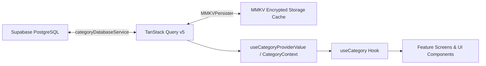
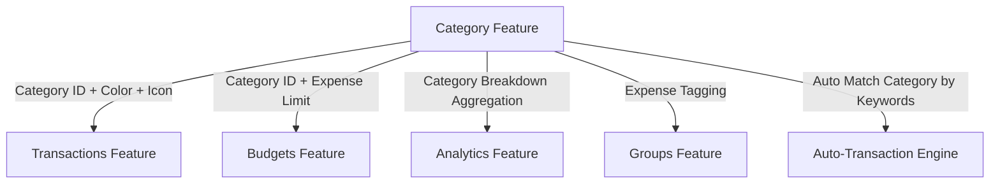

# BuddyIO — Category Feature Documentation

**Feature Name**: Category Management & Classification  
**Status**: Implemented & Production-Ready  
**Domain Layer**: `src/features/categories/`  
**State Model**: TanStack Query + `CategoryContext` with MMKV persistence  
**Design System**: Tamagui v1.141 with Fluid Surface primitives

---

## 1. Feature Overview & Purpose

The **Category Feature** is the foundational taxonomy system in BuddyIO. It classifies every financial flow—income, personal expense, and shared group split—into structured semantic buckets.

Categories drive:

1. **Transaction Classification**: Tagging single and group transactions.
2. **Budget Allocations**: Setting spending thresholds per category.
3. **Visual Analytics**: Generating spending breakdowns, pie charts, and monthly comparison trends.
4. **Auto-Transaction Rules**: Automatically categorizing parsed SMS/bank alerts.

---

## 2. Data Model & Database Schema

### 2.1 Database Schema (`public.categories`)

Categories are persisted in Supabase PostgreSQL under the `categories` table.

```sql
CREATE TABLE public.categories (
    id TEXT PRIMARY KEY,
    user_id UUID REFERENCES auth.users(id) ON DELETE CASCADE,
    name TEXT NOT NULL,
    icon TEXT NOT NULL,
    color TEXT NOT NULL,
    type TEXT NOT NULL CHECK (type IN ('income', 'expense')),
    is_default BOOLEAN NOT NULL DEFAULT false,
    created_at TIMESTAMPTZ NOT NULL DEFAULT now(),
    updated_at TIMESTAMPTZ NOT NULL DEFAULT now()
);
```

### 2.2 TypeScript Interface (`Category`)

```typescript
export interface Category {
  id: string;
  name: string;
  icon: string; // Icon token (Lucide or Ionicons name)
  color: string; // Hex color code (e.g., '#FF5722')
  type: 'income' | 'expense';
  isSystem?: boolean; // True for immutable default categories
}
```

### 2.3 Default System Categories

BuddyIO seeds **18 default categories** (5 Income, 13 Expense) on first user login:

| Type             | Default Categories                                                                                                                                     | Icons                                                                                                                                   | Sample Colors                                                                                                                                 |
| :--------------- | :----------------------------------------------------------------------------------------------------------------------------------------------------- | :-------------------------------------------------------------------------------------------------------------------------------------- | :-------------------------------------------------------------------------------------------------------------------------------------------- |
| **Income (5)**   | `Salary`, `Freelance`, `Investments`, `Gift`, `Other`                                                                                                  | `cash`, `briefcase`, `trending-up`, `gift`, `ellipsis-horizontal`                                                                       | `#4CAF50`, `#2196F3`, `#9C27B0`, `#E91E63`, `#607D8B`                                                                                         |
| **Expense (13)** | `Food`, `Transport`, `Housing`, `Utilities`, `Entertainment`, `Health`, `Shopping`, `Education`, `Personal Care`, `Travel`, `Debt`, `Savings`, `Other` | `restaurant`, `car`, `home`, `flash`, `film`, `medkit`, `cart`, `school`, `person`, `airplane`, `card`, `wallet`, `ellipsis-horizontal` | `#FF5722`, `#FF9800`, `#795548`, `#FFC107`, `#673AB7`, `#F44336`, `#E91E63`, `#3F51B5`, `#009688`, `#03A9F4`, `#F44336`, `#4CAF50`, `#9E9E9E` |

---

## 3. Entry Points & Navigation Routes

```mermaid
flowchart TD
    A[Settings Tab] -->|Tap 'Manage Categories'| B[Manage Categories Screen - app/manage-categories.tsx]
    B -->|Tap '+' Button| C[Add Category Screen - app/add-category.tsx]
    B -->|Tap Category Item| D[Edit Category Screen - app/edit-category.tsx?id=...]
    B -->|Tap History/Details| E[Category Transactions - app/categories/[id].tsx]

    F[Add Transaction Modal] -->|Category Picker BottomSheet| G[Select Category for Transaction]
    H[Budget Setup Screen] -->|Category Budget Allocation| I[Set Monthly Limit per Category]
    J[Group Split Screen] -->|Expense Category Picker| K[Assign Category to Group Bill]
```

### 3.1 Direct Screen Routes (`app/`)

| Route                | File Path                                                                       | Presentation   | Description                                                                                               |
| :------------------- | :------------------------------------------------------------------------------ | :------------- | :-------------------------------------------------------------------------------------------------------- |
| `/manage-categories` | [`app/manage-categories.tsx`](file:///f:/prj/BuddyIO/app/manage-categories.tsx) | Standard Stack | Main management view listing all income and expense categories with tabs, item counts, and quick actions. |
| `/add-category`      | [`app/add-category.tsx`](file:///f:/prj/BuddyIO/app/add-category.tsx)           | Stack / Modal  | Category creation form with Name, Type, Color Palette, and Icon Picker.                                   |
| `/edit-category`     | [`app/edit-category.tsx`](file:///f:/prj/BuddyIO/app/edit-category.tsx)         | Stack / Modal  | Edit form with deletion guards for system categories or categories with active transactions.              |
| `/categories/[id]`   | [`app/categories/[id].tsx`](file:///f:/prj/BuddyIO/app/categories/[id].tsx)     | Stack          | Filtered transaction history belonging strictly to category `[id]`.                                       |

### 3.2 In-App Consumption Entry Points

1. **Settings Screen** (`app/(tabs)/settings/`): Entry point under the _Preferences_ section labeled **Manage Categories**.
2. **Transaction Creation & Editing** (`app/add-transaction.tsx`, `src/features/transactions/`): Category selection sheet triggered during transaction entry.
3. **Budget Planning** (`app/budget-setup.tsx`, `src/features/budgets/`): Allocate budget limits per expense category.
4. **Group Expense Creation** (`app/add-group-transaction.tsx`, `src/features/groups/`): Group transaction category selector.
5. **Analytics Tab** (`app/(tabs)/trackers/`, `src/features/analytics/`): Visual breakdown and comparison filters by category.

---

## 4. State Management & Data Architecture



### 4.1 Architecture Components

- **Service Layer**: [`CategoryDatabaseService.ts`](file:///f:/prj/BuddyIO/src/services/CategoryDatabaseService.ts) and [`src/features/categories/service.ts`](file:///f:/prj/BuddyIO/src/features/categories/service.ts).
  - Handles Supabase REST/PostgREST queries (`select`, `upsert`, `delete`).
- **Query Cache Key**: `queryKeys.categories.list(userId)` -> `['categories', 'list', userId]`.
- **Context & Hook**: [`useCategoryProviderValue.ts`](file:///f:/prj/BuddyIO/src/features/categories/context/useCategoryProviderValue.ts) exposed via [`useCategory()`](file:///f:/prj/BuddyIO/src/context/CategoryContext.tsx).

### 4.2 Available Methods & Properties (`CategoryContextType`)

```typescript
const {
  categories, // Category[] - Current list of active categories
  isLoading, // boolean - Loading or mutation state
  error, // string | null - Error message if mutation fails
  lastSyncTime, // Date | null - Timestamp of last remote synchronization

  addCategory, // (category) => Promise<Category>
  updateCategory, // (id, updates) => Promise<Category>
  updateCategoryName, // (id, name) => Promise<void>
  deleteCategory, // (id) => Promise<void>
  addManyCategories, // (categories[]) => Promise<Category[]>
  deleteManyCategories, // (ids[]) => Promise<void>

  getCategoryById, // (id) => Category | undefined
  getCategoryByName, // (name) => Category | undefined
  findCategories, // (predicate) => Category[]

  validateCategoryDeletion, // (id, txCount) => { canDelete: boolean, reason: string }
  validateCategoryName, // (name, excludeId) => { isValid: boolean, reason?: string }

  exportCategories, // () => { categories, exportDate, version }
  syncWithRemote, // () => Promise<void>
  loadFromRemote, // () => Promise<void>
} = useCategory();
```

---

## 5. UI Architecture & Design System

The Category UI strictly follows BuddyIO's **Fluid Surface Design System** and **Tamagui** tokens.

```
src/features/categories/
├── components/
│   ├── CategoriesScreenFrame.tsx           # Layout frame for category details
│   ├── CategoriesScreenSections.tsx        # Detail sections & transaction history
│   ├── CategoryColorPicker.tsx             # 16-color curated financial palette
│   ├── CategoryIconEditor.tsx              # Grid icon selector with search
│   ├── CategoryFormSections.tsx            # Form fields: Type toggle, Name input
│   ├── EditCategoryScreenFrame.tsx         # Edit screen Fluid Surface container
│   ├── ManageCategoriesScreenFrame.tsx     # Main list container with search & tabs
│   ├── ManageCategoryControls.tsx          # Tab filter (All, Expense, Income)
│   ├── ManageCategoryPrimitives.tsx        # Fluid Surface row badges & icons
│   ├── ManageCategoryRows.tsx              # Virtualized category row item
│   └── ManageCategorySections.tsx          # Grouped sections with count badges
├── hooks/
│   ├── useAddCategoryScreen.ts             # Form state & validation for add
│   ├── useEditCategoryScreen.ts            # Form state & validation for edit
│   ├── useManageCategoriesScreen.ts        # Filtering, tab selection & delete alerts
│   └── useCategoriesScreen.ts              # Category transaction drill-down
```

### 5.1 Design System Rules for Category UI

- **Surface Ownership**: `ScreenContainer` wraps all category screens for blur background. `GlassSurface` wraps category rows, forms, and color selector modals.
- **Touch Targets**: All category row items and icon buttons meet the minimum **48x48 dp** touch target requirement.
- **Theming**: Icon containers dynamically compute contrast ratios against category hex colors in both Dark and Light themes.

---

## 6. Cross-Feature Integrations & Consumers



### 6.1 Transactions Integration

- Each transaction stores `category: string` (category name or ID).
- [`useAddTransactionScreenModel.ts`](file:///f:/prj/BuddyIO/src/features/transactions/hooks/useAddTransactionScreenModel.ts) consumes `categories` to render the picker.
- When rendering transaction lists, [`useCategory()`](file:///f:/prj/BuddyIO/src/context/CategoryContext.tsx) resolves the category's icon and color for the visual badge.

### 6.2 Budget Integration

- In [`useCategoryBudgetSetup.ts`](file:///f:/prj/BuddyIO/src/features/budgets/hooks/useCategoryBudgetSetup.ts), the user allocates a monthly spending budget to expense categories.
- Budget summaries compute `actualSpent` vs `budgetLimit` by filtering transactions by category ID.

### 6.3 Analytics Integration

- [`CategorySpendingChart.tsx`](file:///f:/prj/BuddyIO/src/features/analytics/components/charts/CategorySpendingChart.tsx) groups monthly outflows by category name/ID to render the Donut spending breakdown.
- Automatically handles fallback humanization for legacy or raw category keys.

### 6.4 Auto-Transactions & SMS Parser

- The auto-transaction engine matches merchant keywords (e.g., "Uber" $\rightarrow$ `Transport`, "Starbucks" $\rightarrow$ `Food`, "Salary credit" $\rightarrow$ `Salary`) and attaches the corresponding default category ID.

---

## 7. Business Rules, Validation & Lifecycle

### 7.1 Category Name Validation

- **Required**: Must not be empty or whitespace.
- **Length**: Must be between **2 and 50 characters**.
- **Uniqueness**: Case-insensitive unique check per user (e.g., cannot create "food" if "Food" already exists).

### 7.2 Deletion Rules & Safety Guards

1. **System Categories Protected**:
   - Categories with `isSystem: true` **cannot be deleted** by the user.
2. **Referential Integrity Guard**:
   - If a category is linked to existing transactions (`transactionCount > 0`), the deletion is blocked via `validateCategoryDeletion()` with an alert instructing the user to reassign transactions first.
3. **No Soft Deletion**:
   - When a valid custom category is deleted, it is permanently removed from `public.categories` and evicted from the TanStack query cache.

---

## 8. Failure Modes & Edge Cases

| Scenario                                                  | Behavior / Fallback                                                                                                                               |
| :-------------------------------------------------------- | :------------------------------------------------------------------------------------------------------------------------------------------------ | --- | ------------------------------------------------------------------------------------ |
| **Offline Mode**                                          | Queries resolve from encrypted MMKV cache. New categories are optimistically added to the cache and synced to Supabase when connectivity resumes. |
| **Deleted Category Referenced in Historical Transaction** | Transaction displays `category                                                                                                                    |     | 'Uncategorized'` with a neutral fallback icon and grey color badge without crashing. |
| **First App Launch / No Network**                         | In-memory `DEFAULT_CATEGORIES` list renders immediately to ensure zero UI layout shift or empty screen delay.                                     |
| **Duplicate Category Creation**                           | Validated client-side with inline feedback before mutation is sent to Supabase.                                                                   |

---

## 9. Developer Quick Reference

### How to use categories in a component:

```tsx
import React from 'react';
import {useCategory} from '@/context/CategoryContext';
import {XStack, Text} from 'tamagui';
import {GlassSurface} from '@/components/ui/GlassSurface';
import {AppIcon} from '@/components/ui/AppIcon';

export const CategoryBadge = ({categoryId}: {categoryId: string}) => {
  const {getCategoryById} = useCategory();
  const category = getCategoryById(categoryId);

  if (!category) {
    return <Text color="$colorSubtitle">Uncategorized</Text>;
  }

  return (
    <GlassSurface p="$2" br="$3">
      <XStack ai="center" gap="$2">
        <AppIcon name={category.icon} color={category.color} size={16} />
        <Text color="$color" fontSize="$3" fontWeight="600">
          {category.name}
        </Text>
      </XStack>
    </GlassSurface>
  );
};
```
