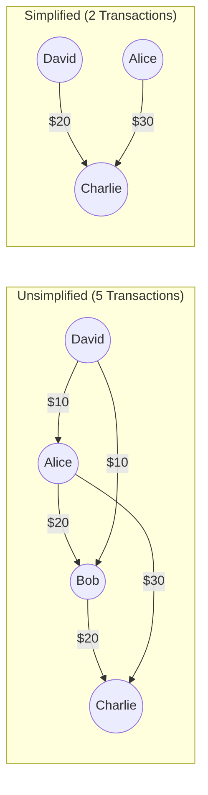

# BuddyIO — Groups & Split Expenses Feature Documentation

**Feature Name**: Groups, Shared Expenses & Debt Settlement  
**Status**: Implemented & Production-Ready  
**Domain Layer**: `src/features/groups/` & `src/workers/debtCalculation/`  
**State Model**: TanStack Query + `EnhancedGroupContext` with MMKV persistence & Supabase Realtime  
**Design System**: Tamagui v1.141 with Fluid Surface primitives

---

## 1. Feature Overview & Purpose

The **Groups & Split Expenses** feature is BuddyIO's collaborative finance engine. It enables users to organize shared expenses (trips, households, events, roommates, couples), split bills with complex allocation algorithms, track individual member balances, and settle debts with optimized minimum-cash-flow routing.

### Core Capabilities

1. **Multi-Member Groups**: Support for real authenticated users (synced via Supabase profile) and virtual offline placeholder members.
2. **Flexible Split Engine**: Equal, exact/custom amounts, percentage-based, and share/ratio-based expense splits.
3. **Debt Graph Optimization**: Algorithm reducing $N$-way bilateral debts into the minimum number of settlement transactions.
4. **Off-Thread Computation**: Web Worker calculation pool preventing UI freezes for high-transaction or large-member groups.
5. **Real-time Synchronization**: Instant multi-device updates via Supabase Realtime subscriptions.
6. **Settlement Tracking & Overpayment Prevention**: Recording debt payments with verification against outstanding balances.

---

## 2. System Architecture & Topology

```mermaid
flowchart TB
    subgraph Client_UI ["Mobile Presentation (Tamagui + Fluid Surface)"]
        A[Groups Tab - app/(tabs)/groups] --> B[Group Detail Screen - app/groups/[id]]
        B --> C[SplitEditor Modal]
        B --> D[Settlement Suggestion Cards]
        B --> E[Member Balances & Activity Feed]
    end

    subgraph State_Layer ["State & Realtime Layer"]
        F[EnhancedGroupContext / GroupQuery]
        G[GroupRealtimeService - Supabase Channels]
        H[MMKV Encrypted Cache]
        F <--> H
        G -.->|Invalidate Queries| F
    end

    subgraph Worker_Engine ["Off-Main-Thread Engine"]
        I[Debt Calculation Worker Pool]
        J[LRU Hash Cache]
        K[Min-Cash-Flow Graph Solver]
        I <--> J
        I --> K
    end

    subgraph Database_Layer ["Supabase Backend"]
        L[(public.groups)]
        M[(public.group_members)]
        N[(public.transactions)]
        O[(public.group_invites)]
    end

    Client_UI --> State_Layer
    Client_UI -.->|Heavy Group Balances| Worker_Engine
    State_Layer <--> Database_Layer
```

---

## 3. Data Model & Database Schema

### 3.1 Database Tables

#### `public.groups`

Stores group metadata, currency, and configuration.

```sql
CREATE TABLE public.groups (
    id TEXT PRIMARY KEY,
    name TEXT NOT NULL,
    description TEXT,
    icon TEXT,                           -- Emoji representation (e.g., '✈️', '🏠')
    created_by UUID REFERENCES auth.users(id) ON DELETE CASCADE NOT NULL,
    currency TEXT DEFAULT 'USD',
    is_active BOOLEAN DEFAULT true,
    settings JSONB DEFAULT '{}'::jsonb,  -- Default split method, notification prefs, settlement strategy
    created_at TIMESTAMPTZ DEFAULT now() NOT NULL,
    updated_at TIMESTAMPTZ DEFAULT now() NOT NULL
);
```

#### `public.group_members`

Maps members to groups, supporting both linked Supabase accounts and offline guest profiles.

```sql
CREATE TABLE public.group_members (
    id UUID PRIMARY KEY DEFAULT gen_random_uuid(),
    group_id TEXT REFERENCES public.groups(id) ON DELETE CASCADE NOT NULL,
    user_id TEXT NOT NULL,               -- Local member UUID
    supabase_user_id UUID REFERENCES auth.users(id) ON DELETE SET NULL,
    display_name TEXT NOT NULL,
    avatar_url TEXT,
    role TEXT NOT NULL CHECK (role IN ('creator', 'member')) DEFAULT 'member',
    invite_email TEXT,
    phone TEXT,
    joined_at TIMESTAMPTZ DEFAULT now() NOT NULL,
    UNIQUE(group_id, user_id)
);
```

#### `public.transactions` (Group Split Columns)

Group expenses and settlements reuse the unified transactions table with specific metadata.

```sql
ALTER TABLE public.transactions ADD COLUMN IF NOT EXISTS group_id TEXT REFERENCES public.groups(id) ON DELETE CASCADE;
ALTER TABLE public.transactions ADD COLUMN IF NOT EXISTS group_name TEXT;
ALTER TABLE public.transactions ADD COLUMN IF NOT EXISTS group_emoji TEXT;
ALTER TABLE public.transactions ADD COLUMN IF NOT EXISTS paid_by TEXT;              -- Member ID who paid
ALTER TABLE public.transactions ADD COLUMN IF NOT EXISTS split_among TEXT[];         -- Array of Member IDs
ALTER TABLE public.transactions ADD COLUMN IF NOT EXISTS split_method TEXT;         -- 'equal'|'custom'|'percentage'|'shares'
ALTER TABLE public.transactions ADD COLUMN IF NOT EXISTS split_amounts JSONB;       -- { memberId: amount }
ALTER TABLE public.transactions ADD COLUMN IF NOT EXISTS split_details JSONB;       -- Array of SplitDetail objects
ALTER TABLE public.transactions ADD COLUMN IF NOT EXISTS is_settlement BOOLEAN DEFAULT false;
ALTER TABLE public.transactions ADD COLUMN IF NOT EXISTS settled_debts TEXT[];
ALTER TABLE public.transactions ADD COLUMN IF NOT EXISTS settled_debt_amounts JSONB;
```

---

## 4. Split Methods & Mathematical Formulation

Let total expense amount be $A$, payer be $P$, and participant set be $M = \{m_1, m_2, \dots, m_k\}$.

### 4.1 Equal Split (`equal`)

Each participant owes:
$$\text{Owed}(m_i) = \text{round}\left(\frac{A}{k}, 2\right)$$
_Rounding Reconciliation_: Any remainder (due to cent rounding $\Delta = A - \sum \text{Owed}(m_i)$) is allocated to the payer $P$ to preserve exact zero-sum ledger balance.

### 4.2 Custom / Exact Amount (`custom`)

Explicit amounts $a_i$ defined per member:
$$\text{Owed}(m_i) = a_i \quad \text{subject to} \quad \sum_{i=1}^k a_i = A$$

### 4.3 Percentage Split (`percentage`)

Percentage $p_i$ defined per member:
$$\text{Owed}(m_i) = \text{round}\left(A \times \frac{p_i}{100}, 2\right) \quad \text{subject to} \quad \sum_{i=1}^k p_i = 100\%$$

### 4.4 Shares / Ratio Split (`shares`)

Weight $w_i$ assigned per member:
$$\text{Total Shares } W = \sum_{i=1}^k w_i \implies \text{Owed}(m_i) = \text{round}\left(A \times \frac{w_i}{W}, 2\right)$$

---

## 5. Debt Simplification & Settlement Algorithms

BuddyIO implements two settlement strategies configured per group:

### 5.1 Pairwise Direct Settlement (`pairwise`)

Preserves bilateral debts exactly as incurred between individual pairs of members.
$$\text{Net Debt}(A, B) = \text{Max}(0, \text{Debt}(A \rightarrow B) - \text{Debt}(B \rightarrow A))$$

### 5.2 Minimized Cash Flow (`minimize_transactions`) — Default

Solves the Minimum Cash Flow Problem on a directed graph using a greedy reduction heuristic:

1. Compute net balance $B_i = \text{Total Paid}_i - \text{Total Owed}_i$ for every member $m_i$.
2. Separate members into **Debtors** ($B_i < 0$) and **Creditors** ($B_i > 0$).
3. Iteratively match the debtor with the largest negative balance and the creditor with the largest positive balance:
   $$\text{Settlement Amount } S = \min(|B_{\text{debtor}}|, B_{\text{creditor}})$$
4. Update balances: $B_{\text{debtor}} \leftarrow B_{\text{debtor}} + S$, $B_{\text{creditor}} \leftarrow B_{\text{creditor}} - S$.
5. Repeat until all balances reach $0$. Reduces an $O(N^2)$ transaction network down to at most $N - 1$ payments.



---

## 6. App Entry Points & Navigation Routes

```mermaid
flowchart TD
    A[Groups Tab - app/(tabs)/groups/index.tsx] -->|Tap Group Card| B[Group Hub - app/groups/[id].tsx]
    A -->|Tap '+' FAB| C[Add Group Screen - app/add-group.tsx]

    B -->|Tap '+' Add Expense| D[Add Expense Screen - app/groups/[id]/add-transaction.tsx]
    B -->|Tap 'Settle Up'| E[Settle Up Modal / Repayment]
    B -->|Tap 'Transactions'| F[All Transactions - app/groups/[id]/all-transactions.tsx]
    B -->|Tap 'Activity'| G[Activity Feed - app/groups/[id]/activity.tsx]
    B -->|Tap 'Settlement History'| H[Settlement Log - app/groups/[id]/settlement-history.tsx]
    B -->|Tap 'Settings / Edit'| I[Edit Group - app/groups/[id]/edit.tsx]

    J[Quick Add Modal] -->|Select Group| K[Find Group & Add - app/find-group-and-add-transaction.tsx]
```

### 6.1 Route Inventory (`app/`)

| Route                             | File Path                                                                                                 | Description                                                                                          |
| :-------------------------------- | :-------------------------------------------------------------------------------------------------------- | :--------------------------------------------------------------------------------------------------- |
| `/(tabs)/groups`                  | [`app/(tabs)/groups/index.tsx`](<file:///f:/prj/BuddyIO/app/(tabs)/groups/index.tsx>)                     | Primary list of all active groups, net owe/owed totals, and filter sheet.                            |
| `/add-group`                      | [`app/add-group.tsx`](file:///f:/prj/BuddyIO/app/add-group.tsx)                                           | Group creation: Name, description, emoji icon, currency selection, and initial member roster.        |
| `/groups/[id]`                    | [`app/groups/[id].tsx`](file:///f:/prj/BuddyIO/app/groups/[id].tsx)                                       | Main dashboard for a group: Balance header, Settle Up suggestions, recent expenses, and member list. |
| `/groups/[id]/add-transaction`    | [`app/groups/[id]/add-transaction.tsx`](file:///f:/prj/BuddyIO/app/groups/[id]/add-transaction.tsx)       | Add group expense with interactive `SplitEditor`, receipt upload, and category tagging.              |
| `/groups/[id]/edit-transaction`   | [`app/groups/[id]/edit-transaction.tsx`](file:///f:/prj/BuddyIO/app/groups/[id]/edit-transaction.tsx)     | Modify existing group expense and recompute debt adjustments.                                        |
| `/groups/[id]/all-transactions`   | [`app/groups/[id]/all-transactions.tsx`](file:///f:/prj/BuddyIO/app/groups/[id]/all-transactions.tsx)     | Full searchable, paginated list of all group expenses and settlements.                               |
| `/groups/[id]/settlement-history` | [`app/groups/[id]/settlement-history.tsx`](file:///f:/prj/BuddyIO/app/groups/[id]/settlement-history.tsx) | Complete ledger of all repayments and debt settlement transactions.                                  |
| `/groups/[id]/activity`           | [`app/groups/[id]/activity.tsx`](file:///f:/prj/BuddyIO/app/groups/[id]/activity.tsx)                     | Real-time chronological audit trail of group changes, additions, and edits.                          |
| `/groups/[id]/edit`               | [`app/groups/[id]/edit.tsx`](file:///f:/prj/BuddyIO/app/groups/[id]/edit.tsx)                             | Manage group name, icon, currency, invite/remove members, or delete group.                           |
| `/find-group-and-add-transaction` | [`app/find-group-and-add-transaction.tsx`](file:///f:/prj/BuddyIO/app/find-group-and-add-transaction.tsx) | Fast unified flow: select group $\rightarrow$ enter expense $\rightarrow$ split $\rightarrow$ save.  |

---

## 7. UI Components & Fluid Surface Visual System

The Group UI is structured in `src/features/groups/components/` following BuddyIO's **Fluid Surface Design System**:

```
src/features/groups/components/
├── GroupCard.tsx                             # Fluid Surface group card in tab list with balance pills
├── SplitEditor.tsx                           # Dynamic split allocation component (Equal, %, Custom, Shares)
├── GroupsScreenHeader.tsx                    # Tab header with total net balance badge
├── GroupsScreenList.tsx                      # Virtualized FlashList rendering group cards
├── GroupsScreenModals.tsx                    # Filter and search modal sheets
├── GroupDetailBalanceSection.tsx             # Visual summary of user's net position (+Owed / -Owes)
├── GroupDetailSettlementSection.tsx          # Actionable "Settle Up" recommendation cards
├── GroupDetailTransactionsSection.tsx        # Mini transaction list inside group dashboard
├── GroupTransactionMemberControls.tsx        # Multi-select member check-chips with avatar badges
├── GroupActivityFeedList.tsx                 # Timeline component for group history
├── AddGroupTransactionCategorySheet.tsx      # Category selector drawer for group expense
└── AddGroupTransactionDetailsSections.tsx    # Amount, date, notes, and receipt upload inputs
```

### Key UI Rules:

- **Surface Ownership**: `ScreenContainer` owns background ambient blur; `GlassSurface` wraps individual group summary cards, member rows, and settlement suggestions.
- **Semantic Washes**:
  - Green translucent wash for positive net balance ("You are owed \$X").
  - Red/Coral translucent wash for negative net balance ("You owe \$X").
  - Neutral glass for all zero-balance cards and general navigation rows.
- **Ergonomics**: All member selection checkboxes, split method tabs, and settlement buttons exceed the **48x48 dp** touch target requirement.

---

## 8. State Management & Realtime Sync

### 8.1 Services Layer

- [`GroupDatabaseService.ts`](file:///f:/prj/BuddyIO/src/services/GroupDatabaseService.ts): CRUD operations for groups, member rosters, and settings.
- [`GroupMemberService.ts`](file:///f:/prj/BuddyIO/src/services/GroupMemberService.ts): Search registered users by email/phone, generate invite tokens, and link Supabase accounts.
- [`GroupRealtimeService.ts`](file:///f:/prj/BuddyIO/src/services/GroupRealtimeService.ts): Subscribes to Supabase postgres_changes for real-time synchronization.
- [`GroupRealtimeInvalidation.ts`](file:///f:/prj/BuddyIO/src/services/GroupRealtimeInvalidation.ts): Auto-invalidates query cache keys upon receiving database mutation payloads.
- [`GroupExportService.ts`](file:///f:/prj/BuddyIO/src/services/GroupExportService.ts): Generates CSV and text export summaries for group ledgers.

### 8.2 Off-Thread Web Worker Engine

- **Files**: [`debtCalculation.worker.ts`](file:///f:/prj/BuddyIO/src/workers/debtCalculation.worker.ts) and [`debtCalculationWorkerService.ts`](file:///f:/prj/BuddyIO/src/services/debtCalculationWorkerService.ts).
- **Execution Threshold**: Groups with $> 15$ members or $> 50$ transactions automatically dispatch calculations to the worker thread.
- **LRU Cache**: Generates compound hash (`generateTransactionHash` + `generateMemberHash`) to return cached balances in $< 1\text{ms}$.

---

## 9. Business Rules, Validation & Protections

### 9.1 Deletion & Member Removal Guards

1. **Unsettled Debt Block**: A member cannot be removed from a group if their balance is non-zero ($|\text{balance}| > 0.01$). All outstanding debts must be settled first.
2. **Creator Leaving**: If the group creator wishes to leave, group ownership must be explicitly transferred to another active member.
3. **Group Deletion**: Deleting a group cascades to delete associated group members and split transaction metadata, requiring explicit confirmation.

### 9.2 Overpayment & Settlement Verification

- Settlement amounts cannot exceed the outstanding debt between two members unless explicitly marked as an **Advance Payment** (which creates a credit balance).
- Settlement transactions do not appear in personal expense analytics as spending—they are tagged with `isSettlement: true` to prevent skewing personal budget charts.

---

## 10. Developer Quick Reference

### How to calculate group balances and retrieve settlements:

```tsx
import React, {useMemo} from 'react';
import {useGroups} from '@/context';
import {calculateGroupBalanceOptimized} from '@/utils/groupBalanceUtils.optimized';
import {GlassSurface} from '@/components/ui/GlassSurface';
import {YStack, Text, XStack, Button} from 'tamagui';

export const GroupSettlementCard = ({groupId}: {groupId: string}) => {
  const {getGroupById} = useGroups();
  const group = getGroupById(groupId);

  const balanceData = useMemo(() => {
    if (!group) return null;
    return calculateGroupBalanceOptimized(group.transactions, group.members);
  }, [group]);

  if (!balanceData || balanceData.settlementSuggestions.length === 0) {
    return <Text color="$colorSubtitle">All settled up!</Text>;
  }

  return (
    <YStack gap="$3">
      {balanceData.settlementSuggestions.map((suggestion) => (
        <GlassSurface key={suggestion.id} p="$3" br="$4">
          <XStack jc="space-between" ai="center">
            <YStack>
              <Text color="$color" fontWeight="700">
                {suggestion.fromMemberName} owes {suggestion.toMemberName}
              </Text>
              <Text color="$colorSubtitle" fontSize="$2">
                ${suggestion.amount.toFixed(2)}
              </Text>
            </YStack>
            <Button size="$3" theme="active">
              Settle
            </Button>
          </XStack>
        </GlassSurface>
      ))}
    </YStack>
  );
};
```
